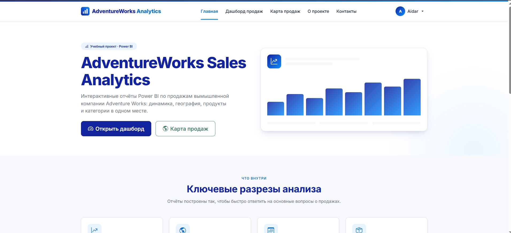
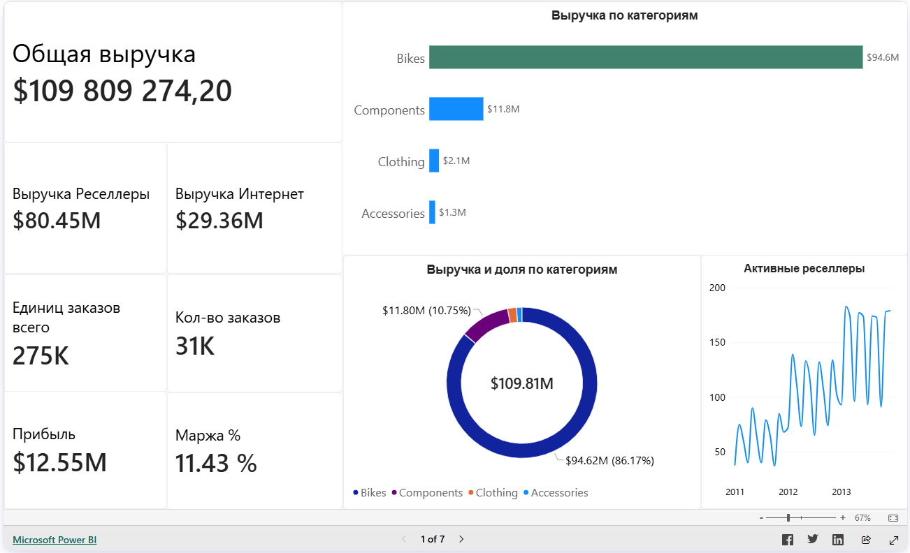
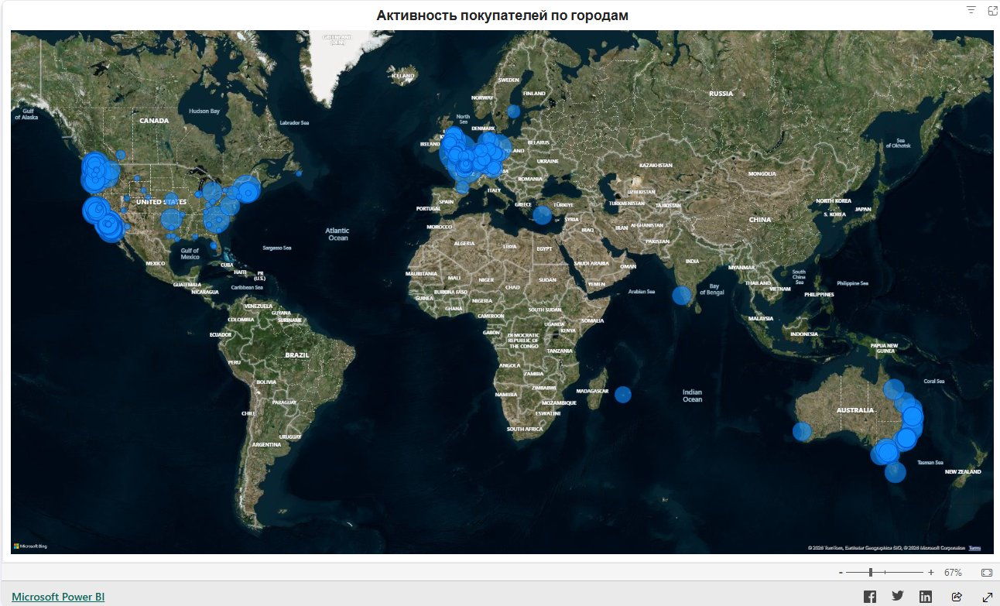

# AdventureWorks Sales Analytics

Учебный веб-проект на **Django**, в который встроены интерактивные отчёты **Power BI**,
построенные на учебном хранилище данных Microsoft **AdventureWorksDW2022**.

- 📊 **Дашборд продаж** — многостраничный отчёт: выручка, прибыль, категории, динамика, слайсеры и фильтры.
- **Карта продаж** — карта мира с городами, где продажи наиболее высоки.
- Регистрация, вход по username или email, профиль, смена и восстановление пароля.
- Форма обратной связи с сохранением сообщений в базу.
- Ссылки на отчёты редактируются в админке без изменения кода.

## Скриншоты

| Главная | Дашборд продаж | Карта продаж |
|---|---|---|
|  |  |  |

> Положите скриншоты в папку `docs/screenshots/`.

## Технологии

- Python 3.15, Django 6.1
- Power BI (Publish to web)
- Bootstrap 5, Bootstrap Icons, шрифт Inter
- SQLite (локально), PostgreSQL (Render)
- WhiteNoise, Gunicorn, Render

## Структура проекта

```
config/        настройки, маршруты, WSGI
core/          главная, «О проекте», контакты (ContactMessage)
accounts/      регистрация, вход, профиль (Profile)
dashboards/    отчёты Power BI (Dashboard)
templates/     шаблоны (base.html, partials/, страницы приложений)
static/        style.css, main.js, favicon.svg
build.sh       сборка на Render
render.yaml    Blueprint для Render
```

## Локальный запуск (Windows)

```powershell
# 1. Виртуальное окружение
py -3.15 -m venv venv
venv\Scripts\Activate.ps1

# 2. Зависимости
pip install -r requirements.txt

# 3. Настройки окружения
Copy-Item .env.example .env
# Сгенерируйте SECRET_KEY и вставьте его в .env:
python -c "from django.core.management.utils import get_random_secret_key; print(get_random_secret_key())"

# 4. База данных и администратор
python manage.py migrate
python manage.py createsuperuser

# 5. Запуск
python manage.py runserver
```

Сайт: http://127.0.0.1:8000/, админка: http://127.0.0.1:8000/admin/

### Переменные окружения

| Переменная | Описание |
|---|---|
| `SECRET_KEY` | секретный ключ Django (обязательно при `DEBUG=False`) |
| `DEBUG` | `True` для разработки, `False` в продакшене |
| `ALLOWED_HOSTS` | разрешённые домены через запятую |
| `CSRF_TRUSTED_ORIGINS` | доверенные источники для CSRF (`https://...`) |
| `DATABASE_URL` | строка подключения PostgreSQL; если не задана — SQLite |
| `SECURE_SSL_REDIRECT` | редирект на HTTPS при `DEBUG=False` (по умолчанию `True`) |
| `POWERBI_SALES_URL` | резервная ссылка на дашборд продаж |
| `POWERBI_MAP_URL` | резервная ссылка на карту продаж |

### Тесты и проверки

```powershell
python manage.py test
$env:DEBUG="False"; python manage.py check --deploy; Remove-Item Env:DEBUG
```

## Как подключить отчёт Power BI

1. Power BI Desktop → **Publish** → **My workspace**.
2. В Power BI Service откройте отчёт → **File → Embed report → Publish to web (public)**.
3. **Create embed code** → **Publish** → скопируйте ссылку вида `https://app.powerbi.com/view?r=...`
   (можно скопировать и весь код `<iframe>` — сайт сам извлечёт ссылку).
4. Админка → **Дашборды** → нажмите на название отчёта → вставьте ссылку в поле **«Ссылка Power BI»** → **Сохранить**.

Для надёжности продублируйте ссылки в переменных `POWERBI_SALES_URL` и `POWERBI_MAP_URL`:
если в базе стоит заглушка, сайт возьмёт ссылку оттуда.

> ⚠️ **Важно:** отчёты, опубликованные через Publish to web, **публичные**: их может открыть
> любой, у кого есть ссылка. Не публикуйте так конфиденциальные данные.
> Данные в опубликованном отчёте обновляются с задержкой **до часа** (кеш Power BI).
> При повторной публикации с заменой (**Replace**) ссылка не меняется.

## Деплой на Render

1. Залейте код на GitHub (файлы `.env` и `db.sqlite3` в репозиторий не попадают — см. `.gitignore`).
2. Render → **New** → **Blueprint** → выберите репозиторий. Render создаст веб-сервис и базу PostgreSQL по `render.yaml`.
3. Задайте переменные: `DJANGO_SUPERUSER_USERNAME`, `DJANGO_SUPERUSER_EMAIL`, `DJANGO_SUPERUSER_PASSWORD`,
   `POWERBI_SALES_URL`, `POWERBI_MAP_URL`.
4. Дождитесь окончания сборки (`build.sh`: зависимости → статика → миграции → суперпользователь).
5. Откройте `https://<имя-сервиса>.onrender.com/admin/` и при необходимости вставьте ссылки Power BI.

### Ограничения бесплатного плана Render

- Сервис **засыпает** после ~15 минут без посещений; первое открытие после сна занимает 30–60 секунд.
- Бесплатная PostgreSQL **ограничена по сроку** (около 30 дней — точный срок проверьте в документации Render).
  После удаления базы пропадут пользователи, сообщения и ссылки, сохранённые в админке.
  Ссылки на отчёты восстановятся автоматически из `POWERBI_SALES_URL` / `POWERBI_MAP_URL`,
  а суперпользователь пересоздастся при следующей сборке из `DJANGO_SUPERUSER_*`.
- Файловая система временная: **загруженные аватары удаляются** при каждом деплое.
  Вместо аватара сайт показывает инициалы пользователя.

## Автор

Айдар Бактыбеков — учебный проект по бизнес-аналитике.
Контакты: см. страницу «Контакты» на сайте.